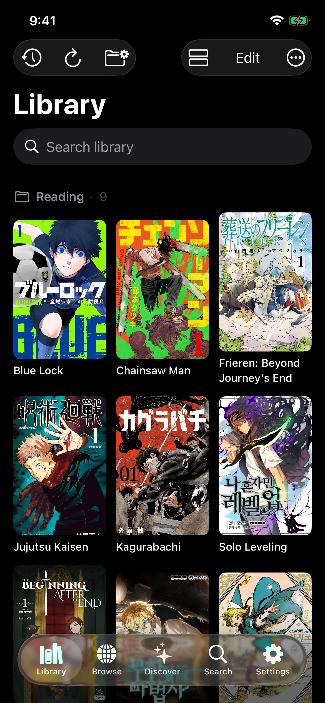
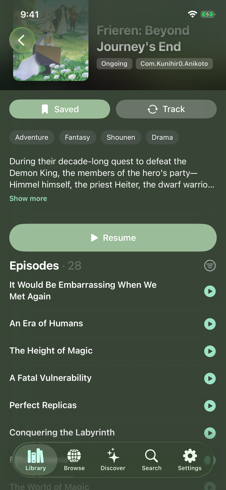
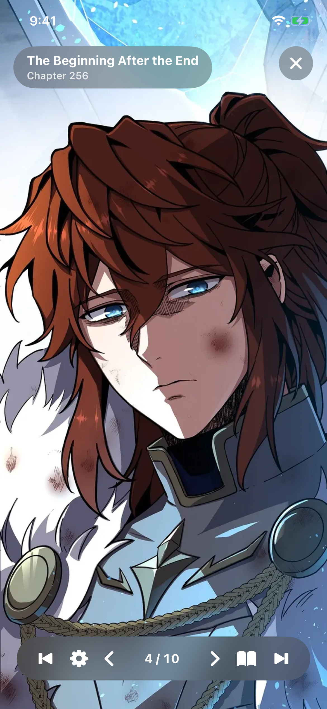
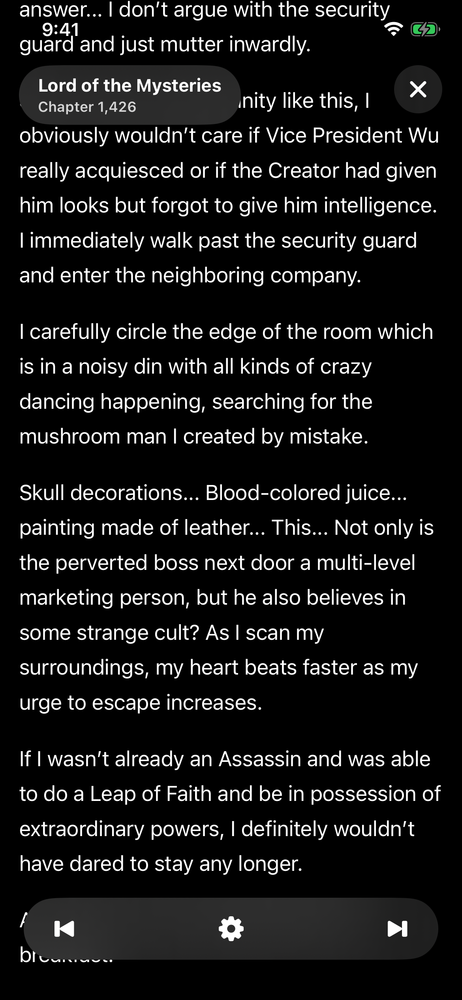

<div align="center">
  

  <h1>Ito</h1>

  <p><strong>Anime, manga, and novels in one native iOS app.</strong></p>
  <p>Free, open source, and ad-free. For iPhone and iPad.</p>

  <p>
    
    <a href="LICENSE">
      
    </a>
    <a href="https://discord.gg/kewAMeJypQ">
      
    </a>
  </p>
</div>

---

## Features

* Native manga and novel readers, plus video playback.
* One library with local history and backups.
* AniList discovery and progress tracking with AniList, MyAnimeList or MangaBaka.
* Extensible `.ito` source plugins with search and source settings.

### Reading history

History groups visits by series and day, with search, media-kind filters, and direct chapter
navigation. It remembers the source's chapter title, number, volume, and scanlation group
(episode language for anime), and shows saved pages, playback times, or novel percentages when
that information is available. Resume prefers the group read last; missing groups fall back to
another release. Missing or locked chapters show an explanation.

Series of the same media kind linked to the same tracker entry can share a History row across
sources. Conflicting tracker links keep them separate. Earlier chapters still open on their own
source. Removing a merged series removes its history from every listed source.

Completed series offer **Read Again** or **Watch Again** on the series screen; History's
**Continue** does not restart an interrupted reread. History keeps at most 2,000 chapters.
Older rows may lack chapter details or positions. Incognito reading is not recorded.

### Tracker ratings

AniList scores can be edited in the tracker entry sheet using the account's scoring format:
100 points, 10 points with or without decimals, five stars, or three smileys. Choose **Not set**
to clear a score. Unchanged scores are preserved, and rating-only edits do not overwrite loaded
progress or status. Automatic progress updates never write scores.
Drafts are tied to the signed-in account session; switching accounts requires reopening the entry.

MyAnimeList supports personal scores from 0–10, and MangaBaka supports personal ratings from
0–100. Ito displays those ratings but leaves editing to their websites under its existing
write policies. Dates remain read-only for all trackers.

## Install

Unsigned builds are published for sideloading. [atiinlabs.github.io/Ito](https://atiinlabs.github.io/Ito/) has one-tap install links for Stable, and [its builds page](https://atiinlabs.github.io/Ito/install/) for both channels.

* **AltStore, SideStore, Feather:** add the source `https://atiinlabs.github.io/Ito/apps.json` (Stable) or `https://atiinlabs.github.io/Ito/apps-dev.json` (Dev, built from every change to `main`).
* **TrollStore:** install the `.tipa` from the [latest release](https://github.com/AtiinLabs/Ito/releases/latest).

## Showcase

<p align="center">
  
  &nbsp;
  
  &nbsp;
  
  &nbsp;
  
</p>

## Build from source

Requires Xcode 26.2 or later. Supports iOS and iPadOS 15.4+.

```sh
git clone https://github.com/AtiinLabs/Ito.git
open Ito/Ito.xcodeproj
```

Let Swift packages resolve, select your signing team and device, then run with `⌘R`.

## Contributing

Focused pull requests and bug reports are welcome. Follow SwiftLint and include behavioral tests. Join the [Discord](https://discord.gg/kewAMeJypQ) for discussion.

Help translate Ito on [Weblate](https://hosted.weblate.org/projects/ito/).

## License

Ito is licensed under the [Mozilla Public License 2.0](LICENSE).

## Content and legal notice

> [!WARNING]
> Ito is a client and does not include or host media sources. Users are responsible for the repositories and plugins they install and for complying with applicable laws, licenses, and service terms. The maintainers do not endorse copyright infringement or other unlawful use.

Series data from [MangaBaka](https://mangabaka.org) is licensed [CC BY-NC-SA 4.0](https://creativecommons.org/licenses/by-nc-sa/4.0/). Ito is not affiliated with AniList, MyAnimeList or MangaBaka.
