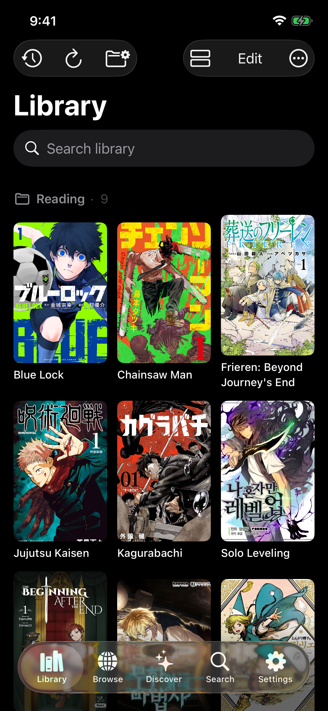
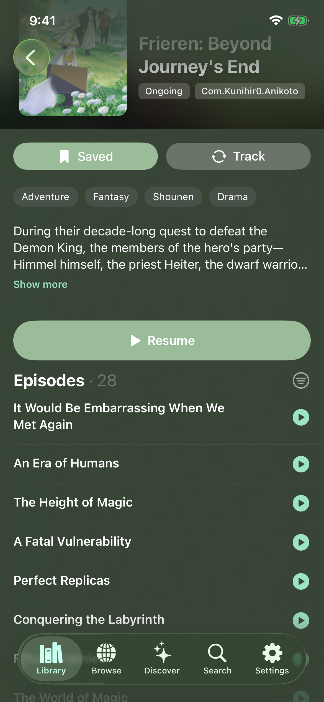
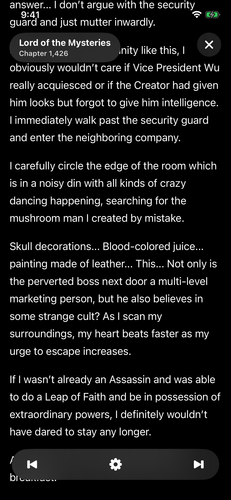

<div align="center">
  

  <h1>Ito</h1>

  <p><strong>Anime, manga, and novels in one native iOS app.</strong></p>
  <p>Discover, read, watch, and track without ads.</p>

  <p>
    
    
    <a href="LICENSE">
      
    </a>
    <a href="https://discord.gg/Es5qTB9BcN">
      
    </a>
  </p>
</div>

---

Ito is a free, open-source client for iPhone and iPad. It combines dedicated readers, native video playback, AniList, MyAnimeList and MangaBaka tracking, and an extensible WebAssembly plugin system in a single app.

## Features

* **Anime, manga, and novels** — Keep different media types together in one library.
* **Native reading** — Dedicated manga and novel readers designed for iOS. A source can mark single chapters as text, so a series can mix page volumes with novel volumes; each opens in the reader that fits it. Known locked chapters stop Start/Resume and adjacent navigation rather than being loaded or skipped.
* **Native video playback** — Select available video quality, audio tracks, and subtitles.
* **AniList discovery** — Browse, search, and filter titles using AniList.
* **Progress tracking** — Connect AniList, MyAnimeList or MangaBaka to track what you read and watch. MangaBaka covers manga and novels.
* **WASM plugins** — Install `.ito` plugins from user-added repositories. Archived repository packages cannot be installed or updated; existing plugins and library data are kept. Downloaded packages are SHA-256 verified before installation.
* **Source recovery** — Search and library-update failures show the source's reason. When a source needs setup or rejects its credentials, open its settings directly from the failure and retry after correcting them.
* **Native source images** — Sources can resolve authenticated image requests for concurrent host downloads. Image exports run in a separate cached WASM instance per source, so a slow legacy image handler does not block browsing or chapter loading. Concurrent first-image requests share one load; settings changes and source updates invalidate that instance. Read-completion delivery uses its own per-attempt instance. Credentials stay transient, destinations are checked against source-declared origins, and cross-origin redirects—including scheme or port changes—are refused. Plugin image caches are partitioned when configuration changes.
* **Source settings diagnostics** — Supporting sources can offer connection checks using an unsaved secret value without storing it. Inline field validation is advisory and never blocks saving settings.
* **Open source links** — Paste a title's web address into Search to open it in the installed source for that site. Only that source sees the link, and links are not kept in recent searches.
* **Source sign-in** — When a source needs you to sign in on its website, Ito opens that site in a private sign-in sheet. Each source's website cookies, and tokens a source obtains itself, are kept separately in the Keychain, never shared with other sources and never included in backups; removing the source or clearing site data deletes them. Sources can't change or remove the API keys and passwords you enter.
* **Self-hosted HTTPS** — Explicitly confirm a self-signed server certificate's SHA-256 fingerprint before connecting. Trust is scoped to that source and exact host, including its native images and read-progress requests. A different untrusted certificate needs confirmation again. Pins stay in the Keychain, outside backups, and are deleted when the source is removed; Clear Site Data keeps them. Certificates already trusted by the device use normal system verification.
* **Backup and migration** — Export native `.itobackup` files or import libraries from Aidoku and Paperback. Source remaps keep same-key media of different kinds separate, including when the destination already owns another kind; conflicting same-kind records are refused without partial changes.
* **On-device storage** — Library data and history are stored locally, with tracker credentials protected by Keychain.
* **No advertisements** — Ito is free and ad-free.

## Install

Unsigned builds are published for sideloading. [atiinlabs.github.io/Ito](https://atiinlabs.github.io/Ito/) has one-tap install links for Stable, and [its builds page](https://atiinlabs.github.io/Ito/install/) for both channels.

* **AltStore, SideStore, Feather:** add the source `https://atiinlabs.github.io/Ito/apps.json` (Stable) or `https://atiinlabs.github.io/Ito/apps-dev.json` (Dev, built from every change to `main`).
* **TrollStore:** install the `.tipa` from the [latest release](https://github.com/AtiinLabs/Ito/releases/latest).

## Showcase

<p align="center">
  
  &nbsp;
  
  &nbsp;
  
  &nbsp;
  
</p>

## Supported imports

| Source         | Formats         |
| -------------- | --------------- |
| Ito            | `.itobackup`    |
| Aidoku         | `.aib`, `.json` |
| Paperback v0.8 | `.pas4`, `.zip` |

Backups can replace the existing library or be merged with it. Imported sources are matched against installed Ito plugins when possible.

## Build from source

### Requirements

* Xcode 26.2 or later
* Swift 6.2
* iOS or iPadOS 15.4 deployment target
* Swift Package Manager

Xcode fetches every dependency, including [`ito-runner`](https://github.com/AtiinLabs/ito-runner), its [`WasmKit`](https://github.com/AtiinLabs/WasmKit) fork and [`anilist-sdk`](https://github.com/AtiinLabs/anilist-sdk), at the revisions pinned in `Package.resolved`. Only Ito needs to be cloned:

```sh
git clone https://github.com/AtiinLabs/Ito.git
open Ito/Ito.xcodeproj
```

Wait for Swift Package Manager to resolve the packages, select a signing team and target device, then build with `⌘R`.

## Contributing

Pull requests are welcome. Keep changes focused, follow the existing SwiftLint configuration, and include tests for behavioral changes where practical.

## License

Ito is licensed under the [Mozilla Public License 2.0](LICENSE).

## Content and legal notice

> [!WARNING]
> Ito is a client and does not include or host media sources. Users are responsible for the repositories and plugins they install and for complying with applicable laws, licenses, and service terms. The maintainers do not endorse copyright infringement or other unlawful use.

Series data from [MangaBaka](https://mangabaka.org) is licensed [CC BY-NC-SA 4.0](https://creativecommons.org/licenses/by-nc-sa/4.0/). Ito is not affiliated with AniList, MyAnimeList or MangaBaka.
