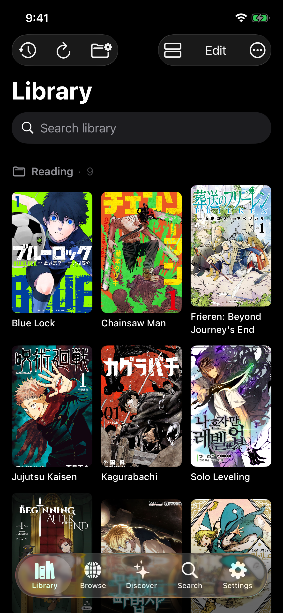
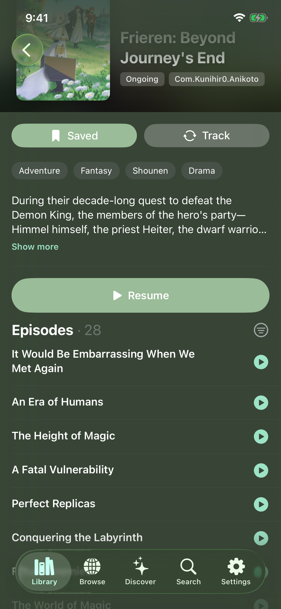
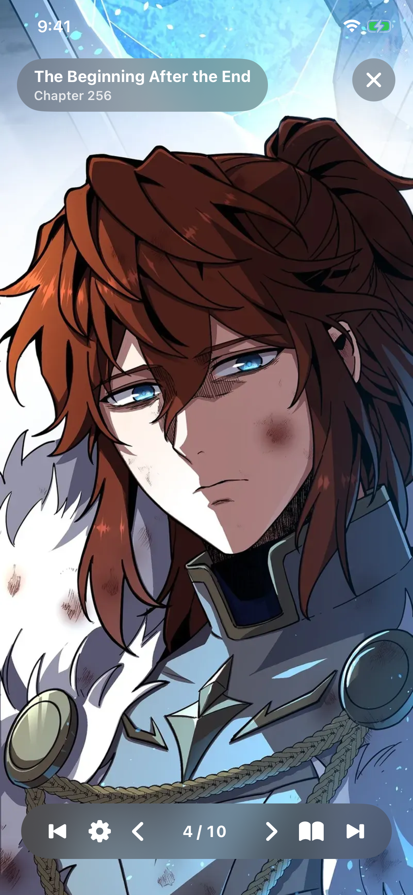
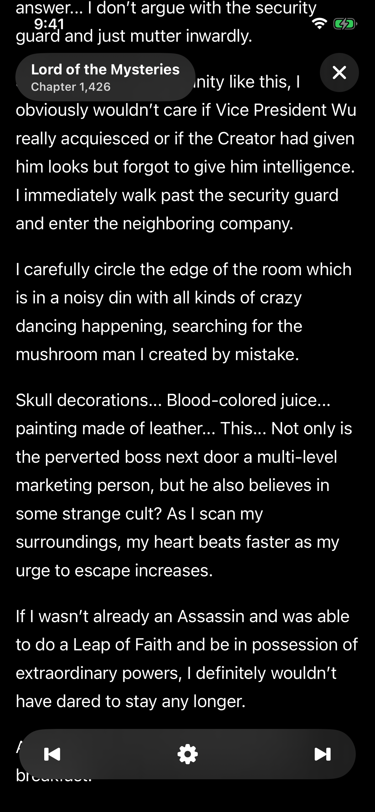

[English](README.md) | [简体中文](README.zh-Hans.md)

<div align="center">
  

  <h1>Ito</h1>

  <p><strong>动画、漫画与小说，集于一款原生 iOS 应用。</strong></p>
  <p>免费、开源、无广告。支持 iPhone 和 iPad。</p>

  <p>
    
    <a href="LICENSE">
      
    </a>
    <a href="https://discord.gg/kewAMeJypQ">
      
    </a>
  </p>
</div>

---

## 功能

* 原生漫画与小说阅读器，并支持视频播放。
* 统一的书库，附带本地历史记录与备份。
* 通过 AniList 发现作品，并支持使用 AniList、MyAnimeList 或 MangaBaka 追踪观看与阅读进度。
* 可扩展的 `.ito` 源插件，支持搜索与源设置。

## 安装

我们发布未签名的构建版本，供侧载（sideloading）使用。[atiinlabs.github.io/Ito](https://atiinlabs.github.io/Ito/) 提供稳定版（Stable）的一键安装链接，[构建版本页面](https://atiinlabs.github.io/Ito/install/)则同时提供两个渠道的安装方式。

* **AltStore、SideStore、Feather：** 添加源 `https://atiinlabs.github.io/Ito/apps.json`（稳定版）或 `https://atiinlabs.github.io/Ito/apps-dev.json`（开发版，`main` 分支每次变更都会自动构建）。
* **TrollStore：** 从[最新发布版本](https://github.com/AtiinLabs/Ito/releases/latest)中安装 `.tipa` 文件。

## 截图展示

<p align="center">
  
  &nbsp;
  
  &nbsp;
  
  &nbsp;
  
</p>

## 从源码构建

需要 Xcode 26.2 或更高版本。支持 iOS 和 iPadOS 15.4 及以上版本。

```sh
git clone https://github.com/AtiinLabs/Ito.git
open Ito/Ito.xcodeproj
```

等待 Swift 包解析完成，选择你的签名团队和设备，然后按 `⌘R` 运行。

## 参与贡献

欢迎提交聚焦单一改动的 Pull Request（PR）和问题反馈。请遵循 SwiftLint 规范，并附上行为测试。欢迎加入 [Discord](https://discord.gg/kewAMeJypQ) 参与讨论。详见[贡献指南](CONTRIBUTING.zh-Hans.md)。

欢迎在 [Weblate](https://hosted.weblate.org/projects/ito/) 上帮助翻译 Ito。

## 许可证

Ito 采用 [Mozilla Public License 2.0](LICENSE) 许可证。

## 免责声明

> [!WARNING]
> Ito 仅为客户端，本身不包含也不托管任何媒体资源。用户需自行对所安装的仓库和插件负责，并遵守适用的法律法规、许可协议及服务条款。维护者不认可任何侵犯版权或其他违法用途。

来自 [MangaBaka](https://mangabaka.org) 的作品数据采用 [CC BY-NC-SA 4.0](https://creativecommons.org/licenses/by-nc-sa/4.0/) 许可。Ito 与 AniList、MyAnimeList 及 MangaBaka 均无关联。

> 本文为英文 [README](README.md) 的中文译本，如有出入，以英文原文为准。
