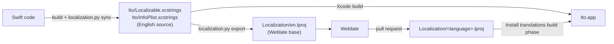

# Localization

Help translate Ito on [Weblate](https://hosted.weblate.org/projects/ito/).
This page explains how localization works for developers and translators.

## How it works



- **The String Catalogs are the English source.** `Ito/Localizable.xcstrings` holds every
  string the app shows; `Ito/InfoPlist.xcstrings` holds the file type names from
  `Info.plist`. They hold English only.
- **`Localization/` is Weblate's.** `Localization/en.lproj` is generated from the
  catalogs and is the base Weblate translates from. Weblate commits translations to
  `Localization/<language>.lproj` (for example `fr.lproj`, `pt-BR.lproj`,
  `zh-Hans.lproj`). Never edit translations anywhere else.
- **The build installs them.** The app target's *Install translations* build phase
  copies every language in `Localization/` into the app as `.strings` and
  `.stringsdict` tables. A string a language has not translated yet shows in English.
  A translation whose placeholders don't match English (for example `%@` where English
  has `%lld`) is left out with a build warning, so a mistake shows English instead of
  crashing.
- Weblate cannot read String Catalogs, so `.github/scripts/localization.py` writes the
  English text to files it can: `.strings` for plain strings, and `Localizable.json`
  (Weblate's *go-i18n v2 JSON* format, which names each plural form) for plurals. Apple's
  own `.stringsdict` is not used on Weblate: Weblate does not write Russian, Ukrainian
  or Polish plurals to it, and it changes keys that contain a colon. The build turns the
  JSON into `.stringsdict`, adding the `other` form Apple needs where a language only
  uses it for fractions.

## Writing strings in code

- SwiftUI literals are localized as they are: `Text("Library")`, `Button("Cancel")`,
  `.navigationTitle("Settings")`, `Label("Delete", systemImage: "trash")`.
- Text kept in a `String` (view-model messages, errors, option names) is created with
  `String(localized: "…")`, for example
  `var errorDescription: String? { String(localized: "The backup could not be read.") }`.
- Write whole sentences and interpolate values: `String(localized: "Couldn't add \(name)")`.
  Never join translated fragments.
- Counts are a single interpolated string, `Text("\(count) chapters")`. Give the key
  plural forms in the catalog (Xcode: right-click the string, *Vary by Plural*).
- Show option names through a localized property (`localizedTitle`), never `rawValue`.
- Add `comment:` when a short string is ambiguous:
  `Text("Read", comment: "Button that marks a chapter as read")`.
- Source, plugin, tracker and user content is data and is never translated: titles,
  descriptions, plugin settings and error text, repository names, category names.
  `Text(someString)` shows a `String` variable as it is.
- Dates, numbers and sizes use locale-aware formatting (`Text(date, style: .date)`,
  `.formatted()`, `ByteCountFormatter`).

### After changing strings

Command-line builds do not update the catalog, so sync it before opening a pull request.
Use the Xcode version CI uses and a derived data folder of its own, so files from
deleted sources or other configurations are not picked up:

```sh
rm -rf build/DerivedData
xcodebuild -project Ito.xcodeproj -scheme Ito \
  -destination 'generic/platform=iOS Simulator' \
  -derivedDataPath build/DerivedData CODE_SIGNING_ALLOWED=NO build
.github/scripts/localization.py sync --derived-data build/DerivedData
```

`sync` adds new strings to `Ito/Localizable.xcstrings`, marks removed ones as stale and
rewrites `Localization/en.lproj`. Xcode's editor also adds new strings to the catalog
while you work, but run `sync` before committing so the catalog matches what CI
extracts. After editing the catalog by hand (comments, plural forms), run
`.github/scripts/localization.py export`. Commit the catalog and `Localization/en.lproj`
with your change.

CI fails when the catalog is missing strings the code uses, when `Localization/en.lproj`
is out of date, or when a translation has placeholders that don't match English.

## Translating

Translate on [Weblate](https://hosted.weblate.org/projects/ito/); pull requests that edit
`Localization/` by hand are not accepted.
Placeholders such as `%@` and `%lld` stand for values the app fills in and must stay in
the translation. Use `%1$@`, `%2$@` to change their order. Plural strings have one field
per plural form of your language.

To test a translation locally, put the files Weblate produced in
`Localization/<language>.lproj`, build, and run the app with that language selected in
the simulator's Settings or with the launch arguments `-AppleLanguages (<language>)`.
