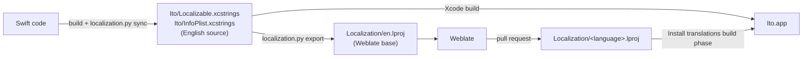

[English](../LOCALIZATION.md) | [简体中文](LOCALIZATION.md)

# 本地化

欢迎在 [Weblate](https://hosted.weblate.org/projects/ito/) 上帮助翻译 Ito。
本文面向开发者和译者，介绍 Ito 的本地化工作方式。

## 工作原理



- **字符串目录（String Catalog）是英文原文的来源。** `Ito/Localizable.xcstrings` 包含应用中显示的所有字符串；`Ito/InfoPlist.xcstrings` 包含 `Info.plist` 中的文件类型名称。它们只存放英文。
- **`Localization/` 由 Weblate 管理。** `Localization/en.lproj` 由字符串目录生成，是 Weblate 翻译时使用的基准文件。Weblate 会把译文提交到 `Localization/<language>.lproj`（例如 `fr.lproj`、`pt-BR.lproj`、`zh-Hans.lproj`）。请勿在其他任何地方编辑译文。
- **构建时自动安装译文。** 应用 target 的 *Install translations* 构建阶段会把 `Localization/` 中的每种语言以 `.strings` 和 `.stringsdict` 表的形式复制进应用。某种语言尚未翻译的字符串会显示英文。若某条译文的占位符与英文原文不匹配（例如英文是 `%lld`，译文却写成 `%@`），该译文将被忽略并触发构建警告。这样，翻译出错时应用会回退（fallback）显示英文，而不会导致崩溃。
- Weblate 无法读取字符串目录，因此 `.github/scripts/localization.py` 会把英文文本写成 Weblate 能读取的文件：普通字符串写成 `.strings`，复数字符串写成 `Localizable.json`（即 Weblate 的 *go-i18n v2 JSON* 格式，它为每个复数形式单独命名）。Weblate 上不使用 Apple 自己的 `.stringsdict`：Weblate 写入 `.stringsdict` 时不会写出俄语、乌克兰语和波兰语的复数形式，而且会改动含冒号的键。构建时会把 JSON 转换为 `.stringsdict`；对于只在小数中使用 `other` 形式的语言，还会补上 Apple 要求的 `other` 形式。

## 在代码中编写字符串

- SwiftUI 字面量会按原样进行本地化：`Text("Library")`、`Button("Cancel")`、`.navigationTitle("Settings")`、`Label("Delete", systemImage: "trash")`。
- 保存在 `String` 中的文本（视图模型消息、错误信息、选项名称）使用 `String(localized: "…")` 创建，例如 `var errorDescription: String? { String(localized: "The backup could not be read.") }`。
- 请写完整的句子，再把值插入其中：`String(localized: "Couldn't add \(name)")`。切勿拼接已翻译的片段。
- 计数使用单个插值字符串，例如 `Text("\(count) chapters")`。并在字符串目录中为该键设置复数形式（在 Xcode 中右键点击该字符串，选择 *Vary by Plural*）。
- 选项名称请通过本地化属性（`localizedTitle`）显示，切勿直接使用 `rawValue`。
- 短字符串含义不明确时，请添加 `comment:`：`Text("Read", comment: "Button that marks a chapter as read")`。
- 来自数据源、插件、进度追踪服务（tracker）以及用户的内容属于数据，不会被翻译：包括标题、简介、插件设置和错误文本、仓库名称、分类名称。`Text(someString)` 会原样显示一个 `String` 变量。
- 日期、数字和文件大小使用区域感知的格式化方式（`Text(date, style: .date)`、`.formatted()`、`ByteCountFormatter`）。

### 修改字符串之后

命令行构建不会更新字符串目录，因此在提交 Pull Request（PR）之前请先同步。请使用与 CI 相同的 Xcode 版本，并为其单独指定一个 DerivedData 目录，以免把已删除的源文件或其他构建配置产生的文件也一并收录：

```sh
rm -rf build/DerivedData
xcodebuild -project Ito.xcodeproj -scheme Ito \
  -destination 'generic/platform=iOS Simulator' \
  -derivedDataPath build/DerivedData CODE_SIGNING_ALLOWED=NO build
.github/scripts/localization.py sync --derived-data build/DerivedData
```

`sync` 会把新字符串添加到 `Ito/Localizable.xcstrings`，将已删除的字符串标记为过时（stale），并重写 `Localization/en.lproj`。你在 Xcode 编辑器中工作时，它也会把新字符串加入字符串目录，但请在提交前运行 `sync`，确保字符串目录与 CI 提取的结果一致。手动编辑字符串目录（注释、复数形式）之后，请运行 `.github/scripts/localization.py export`。请将字符串目录和 `Localization/en.lproj` 与你的改动一起提交。

出现以下情况时 CI 会失败：字符串目录缺少代码中用到的字符串、`Localization/en.lproj` 已过期，或某条译文的占位符与英文不一致。

## 翻译

请在 [Weblate](https://hosted.weblate.org/projects/ito/) 上翻译；手动编辑 `Localization/` 的 PR 不会被接受。
`%@`、`%lld` 等占位符代表应用运行时填入的值，必须保留在译文中。如需调整它们的顺序，请使用 `%1$@`、`%2$@`。复数字符串会针对你所用语言的每种复数形式各提供一个输入框。

如需在本地测试译文，请把 Weblate 生成的文件放到 `Localization/<language>.lproj`，然后构建应用，并在模拟器的“设置”中选择该语言，或使用启动参数 `-AppleLanguages (<language>)` 运行。

> 本文为英文 [LOCALIZATION.md](../LOCALIZATION.md) 的中文译本，如有出入，以英文原文为准。
